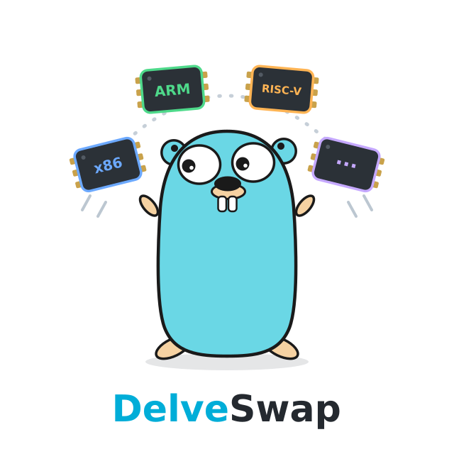
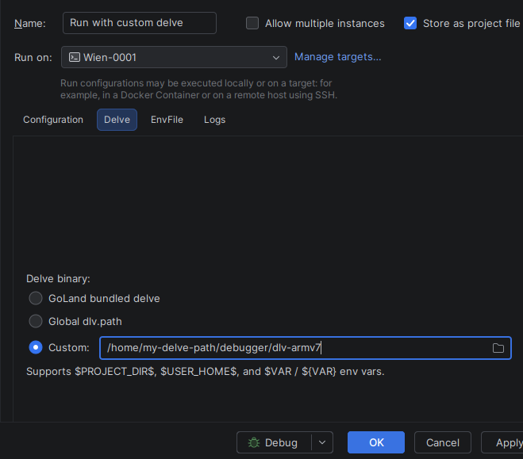

# DelveSwap - Choose Delve per Run Configuration

[](https://github.com/Hoss-Mobility/delve-swap/actions/workflows/ci.yml)
[](LICENSE)
[](https://plugins.jetbrains.com/plugin/32640-delveswap?noRedirect=true)


<p align="center">
  <a href="https://plugins.jetbrains.com/plugin/32640-delveswap?noRedirect=true"></a> 
</p>

**tl;dr**: Get the Plugin from [JetBrains Marketplace](https://plugins.jetbrains.com/plugin/32640-delveswap) 

Want to debug ARM, RISC-V, or other architectures using GoLand? Sick and tired of global magic variables
and needing to restart the IDE after changing them? Look no further!

DelveSwap lets you set a Delve (`dlv`) debugger **per Run Configuration**.
You can create run configurations for x86 development and remote ARMv7
debugging — **AND** version them in Git so every developer on your team has
the same setup!

## Usage

With DelveSwap, all Go Build / Go Test run configurations (including their
Run-on-Target SSH variants) get a **Delve** section with three choices:

- **GoLand bundled delve** — the `dlv` shipped with GoLand.
- **Global dlv.path** (default) — the IDE-wide setting, re-read at each launch.
- **Custom** — a specific binary; supports `$PROJECT_DIR$`, `$USER_HOME$`, and
  `$VAR` / `${VAR}` env vars.

Pick one, save, debug. Two projects (even in the same GoLand instance) can
debug with different Delve binaries at the same time without one leaking into
the other (see [Limitations](#limitations) for one narrow exception).



## Install

Requires GoLand **2026.1 – 2026.2** (the compatibility cap is raised as new
GoLand releases are verified).

- **From disk:** download the latest `.zip` from
  [Releases](https://github.com/Hoss-Mobility/delve-swap/releases), then
  GoLand → Settings → Plugins → ⚙ → Install plugin from disk.
- **[Marketplace](https://plugins.jetbrains.com/plugin/32640-delveswap):** search "DelveSwap" under Settings → Plugins → Marketplace

## Why

GoLand has exactly one Delve setting, the global `dlv.path` property, and
changing it normally requires an IDE restart. Cross-architecture development
(say, an ARMv7 target next to your host) means a different `dlv` per project or run —
and a restart every time you switch debuggers. This issue has been submitted to JetBrains,
but was flagged as "Not on JetBrains' roadmap" ([GO-19800](https://youtrack.jetbrains.com/issue/GO-19800)).

## How it works

The Go plugin decides which `dlv` to launch by reading the `dlv.path` JVM
system property at debug start. DelveSwap hooks each launch with an
`ExecutionListener`: it resolves the configured override (macro and env-var
expansion, then an exists+executable check), writes it into `dlv.path`, and
restores the original value when the debug session ends. Around that core:

- Concurrent sessions are reference-counted — the original value is captured at
  the first active session and restored after the last one ends.
- A sentinel file preserves the original across an IDE crash mid-session and is
  replayed on the next IDE start.
- Run-on-Target (SSH) debug runs two back-to-back executions (a build phase,
  then the real debug); the override is re-applied at the second phase, which
  is what makes per-config overrides work for remote targets too.
- If a Custom path fails validation, the launch falls back to the global
  `dlv.path` and shows a notification instead of breaking the debug session.

## Limitations

- **Go Build and Go Test only** (including Run-on-Target). Go Remote attaches
  to an already-running `dlv` on the remote host, so a local-binary override
  doesn't apply.
- **"GoLand bundled delve" on Run-on-Target:** for Run-on-Target (SSH) debug,
  the *bundled* choice currently resolves to whatever the global `dlv.path`
  says during the real debug phase (the bundled binary only when the global
  setting is empty). If you need a specific binary uploaded to the target,
  use *Custom* with an explicit path.
- **Near-simultaneous launches:** if two debug sessions are scheduled so close
  together that both overrides are applied before either debugger reads
  `dlv.path`, both sessions use the later session's binary (last-writer-wins).
  Rare in practice; a per-session fix is tracked as a follow-up.

## Trust boundary

The override path is stored in the run-configuration XML — which is the point:
commit it so the whole team shares the setup. But it also means anyone who can
commit run-config XML to your repo chooses the Delve binary your IDE launches
the next time you debug. DelveSwap validates that the path exists and is
executable before swapping, so an attacker still has to land a binary at the
resolved path. For shared run configurations prefer `$PROJECT_DIR$/...` paths
(the binary lives inside the reviewed project tree) over `$USER_HOME$/...` or
absolute paths.

## Contributing

```bash
./gradlew test           # JUnit 5 unit tests, no IDE bootstrap
./gradlew buildPlugin    # → build/distributions/delveswap-*.zip
./gradlew runIde         # sandbox GoLand with the plugin loaded
```

The Gradle wrapper provisions Gradle and JDK 21 automatically. See
[CONTRIBUTING.md](CONTRIBUTING.md) for gradle properties, code style, and the
release flow. Bugs and questions:
[issues](https://github.com/Hoss-Mobility/delve-swap/issues).

Maintainers: [skast](https://github.com/skast96), [ddibiasi](https://github.com/ddibiasi)

## License

[MIT](LICENSE)

---

Made with ❤️ by the [Hoss Mobility](https://www.hoss-mobility.com/) [Software Team](https://github.com/Hoss-Mobility)

The DelveSwap gopher is based on the Go gopher designed by
[Renée French](https://reneefrench.blogspot.com/), licensed under
[CC BY 4.0](https://creativecommons.org/licenses/by/4.0/).
